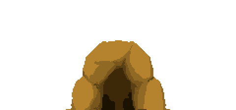
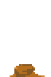
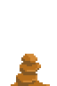
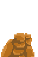
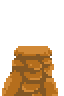
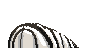
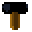
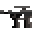
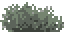
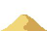

<p align="center">
  
</p>

## Projet

Kingdune est un projet d'apprentissage pour du TS pur. Tout est fait à la main, aucune lib.

J'avais simplement envie de jouer avec les canvas en HTML et voir si je pouvais faire une petite ébauche d'un jeu avec des mécaniques et un gameplay accessible et que je connaisse bien : c'est tombé sur les jeux de la série des [Kingdom](https://kingdomthegame.com/) : [Kingdom Classic](https://store.steampowered.com/app/368230/Kingdom_Classic/) _gratuit sur Steam !_, [Kingdom New Lands](https://store.steampowered.com/app/496300/Kingdom_New_Lands/), [Kingdom Two Crowns](https://store.steampowered.com/app/701160/Kingdom_Two_Crowns/) et [leurs DLC](https://kingdomthegame.com/kingdom-two-crowns/) !
Comme le but n'est pas du tout de faire une copie des assets des jeux, je me suis dit que j'allais les faire moi-même, et comme je suis en train de lire la saga [Dune](<https://fr.wikipedia.org/wiki/Dune_(roman)>) de Frank Herbert en ce moment, je me suis dit que ce serait parfait d'essayer de mêler les deux univers. Et bim "King-dune" !

C'est un projet "fan", ça n'arrive pas à la cheville des jeux Kingdom, donc vraiment, si vous ne connaissez pas, allez-y, essayez-les, ce sont de super jeux ! Et lisez Dune, c'est vraiment un univers de fou !

## Jouer

Vous pouvez "jouer" ou plutôt essayer un truc [ICI](https://pgaillot.github.io/kingdune/)

### Les Touches

| Action | Touche     |
| ------ | ---------- |
| droite | `→` ou `d` |
| gauche | `←` ou `q` |
| action | `↓` ou `s` |

### Les Personnages

Pour le moment j'ai pas encore dessiné les personnages en pixels donc :

- Vous jouez le Naïb representé par un rectangle violet.
- Les rectangle blancs sont des "sans abris"
- les bleu clair sont des fremens du sietch
- les verts des ouvriers
- les noirs des chasseurs

## Les Batiments

### le Sietch :

<table>
  <tr align="center" valign="middle"><th>Niveau</th><th>Image</th><th>Prix</th></tr>
  <tr align="center" valign="middle"><td>0</td><td></td><td>0</td></tr>
  <tr align="center" valign="middle"><td>1</td><td></td><td>3</td></tr>
  <tr align="center" valign="middle"><td>2</td><td></td><td>8</td></tr>
  <tr align="center" valign="middle"><td>3</td><td></td><td>12</td></tr>
</table>

*_Je n'ai dessiné que le niveau 0 pour le moment, donc c'est le même pour tout les niveaux. (pour le moment)_

### les Murs

<table>
  <tr align="center" valign="middle"><th>Niveau</th><th>Image</th><th>Prix</th><th>Vie</th><th>Work charge</th></tr>
  <tr align="center" valign="middle"><td>0</td><td></td><td>0</td><td>0</td><td>0</td></tr>
  <tr align="center" valign="middle"><td>1</td><td></td><td>1</td><td>10</td><td>1.5</td></tr>
  <tr align="center" valign="middle"><td>2</td><td></td><td>3</td><td>25</td><td>2.5</td></tr>
  <tr align="center" valign="middle"><td>3</td><td></td><td>5</td><td>50</td><td>5</td></tr>
</table>

### Les Camps de sans-abris

<table>
  <tr align="center" valign="middle"><th>Image</th><th>Taille</th><th>Pyons max</th><th>Un pyon toutes les</th></tr>
  <tr align="center" valign="middle"><td></td><td>6 m × 3 m</td><td>2</td><td>60 s</td></tr>
</table>

### Les Boutiques

<table>
  <tr align="center" valign="middle"><th>Outil</th><th>Image</th><th>Prix</th><th>Outils max</th><th>Position</th></tr>
  <tr align="center" valign="middle"><td>Marteau</td><td></td><td>3</td><td>4</td><td>-6 m</td></tr>
  <tr align="center" valign="middle"><td>Pistolet maula</td><td></td><td>2</td><td>4</td><td>6 m</td></tr>
</table>

## Le Décor

### Les Buissons

<table>
  <tr align="center" valign="middle"><th>Image</th><th>Taille</th><th>Muad'dib max</th><th>Un muad'dib toutes les</th></tr>
  <tr align="center" valign="middle"><td></td><td>2 m × 1 m</td><td>3</td><td>10 s</td></tr>
</table>

### Les Dunes

<table>
  <tr align="center" valign="middle"><th>Dune</th><th>Dune marquée</th><th>Prix</th><th>Work charge</th><th>Workers</th><th>Récompense</th></tr>
  <tr align="center" valign="middle"><td></td><td></td><td>1</td><td>2.5</td><td>1</td><td>1 ou 2 anneaux</td></tr>
</table>

### Le Soleil et la Lune

<table>
  <tr align="center" valign="middle"><th>Astre</th><th>Image</th><th>Taille</th><th>Décalage</th><th>Durée d'une journée</th></tr>
  <tr align="center" valign="middle"><td>Soleil</td><td></td><td>3 m</td><td>0°</td><td>5 min</td></tr>
  <tr align="center" valign="middle"><td>Lune</td><td></td><td>3 m</td><td>180°</td><td>5 min</td></tr>
</table>

## Les Objets

### Les Anneaux d'eau

<table>
  <tr align="center" valign="middle"><th>Anneau</th><th>Placeholder</th><th>Taille</th></tr>
  <tr align="center" valign="middle"><td></td><td></td><td>1 m × 1 m</td></tr>
</table>

## Development server

To start a local development server, run:

```bash
bun run dev
```

```bash
bun run build
```
