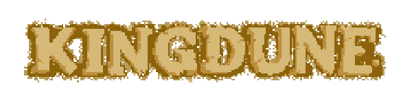

<p align="center">
  
</p>

## Projet

Kingdune est un projet d'apprentissage pour du TS pur. Tout est fait à la main, aucune lib.

J'avais simplement envie de jouer avec les canvas en HTML et voir si je pouvais faire une petite ébauche d'un jeu avec des mécaniques et un gameplay accessible et que je connaisse bien : c'est tombé sur les jeux de la série des [Kingdom](https://kingdomthegame.com/) : [Kingdom Classic](https://store.steampowered.com/app/368230/Kingdom_Classic/) _gratuit sur Steam !_, [Kingdom New Lands](https://store.steampowered.com/app/496300/Kingdom_New_Lands/), [Kingdom Two Crowns](https://store.steampowered.com/app/701160/Kingdom_Two_Crowns/) et [leurs DLC](https://kingdomthegame.com/kingdom-two-crowns/) !
Comme le but n'est pas du tout de faire une copie des assets des jeux, je me suis dit que j'allais les faire moi-même, et comme je suis en train de lire la saga [Dune](<https://fr.wikipedia.org/wiki/Dune_(roman)>) de Frank Herbert en ce moment, je me suis dit que ce serait parfait d'essayer de mêler les deux univers. Et bim "King-dune" !

C'est un projet "fan", ça n'arrive pas à la cheville des jeux Kingdom, donc vraiment, si vous ne connaissez pas, allez-y, essayez-les, ce sont de super jeux ! Et lisez Dune, c'est vraiment un univers de fou !

## Jouer

Vous pouvez "jouer" ou plutôt essayer un truc [ICI](https://pgaillot.github.io/kingdune/)

### Les Touches

| Action | Touche     |
| ------ | ---------- |
| droite | `→` ou `d` |
| gauche | `←` ou `q` |
| action | `↓` ou `s` |

## Development server

To start a local development server, run:

```bash
bun run dev
```

```bash
bun run build
```
